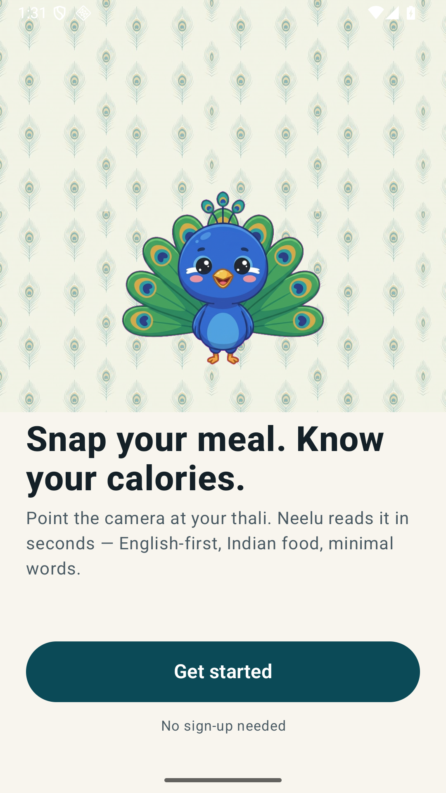
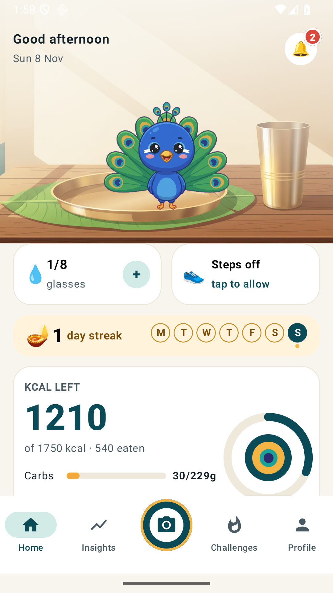
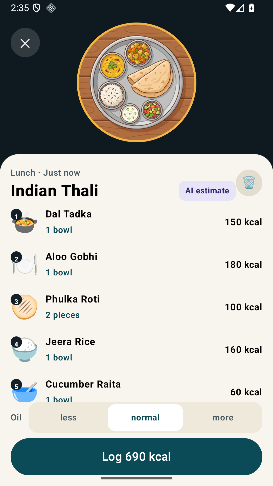
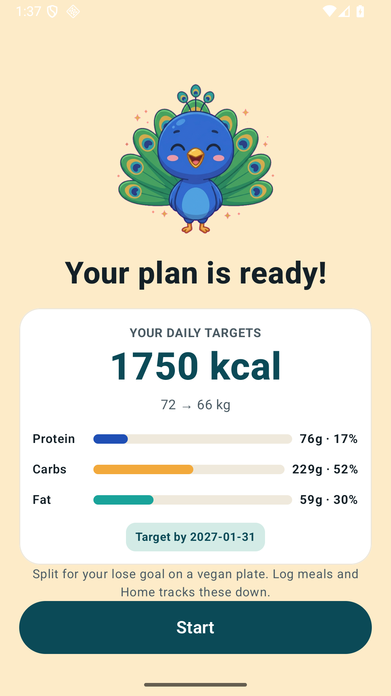
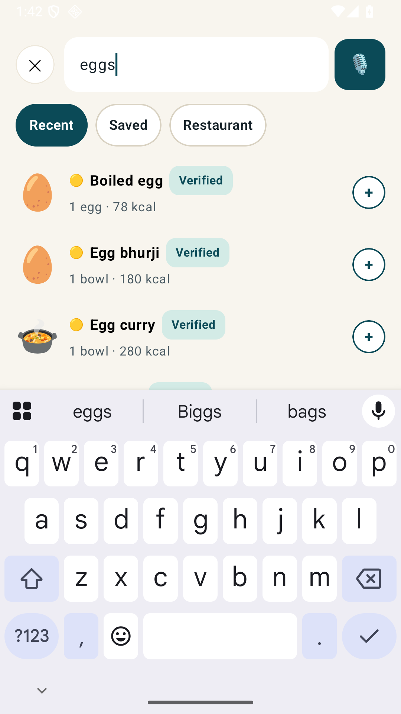
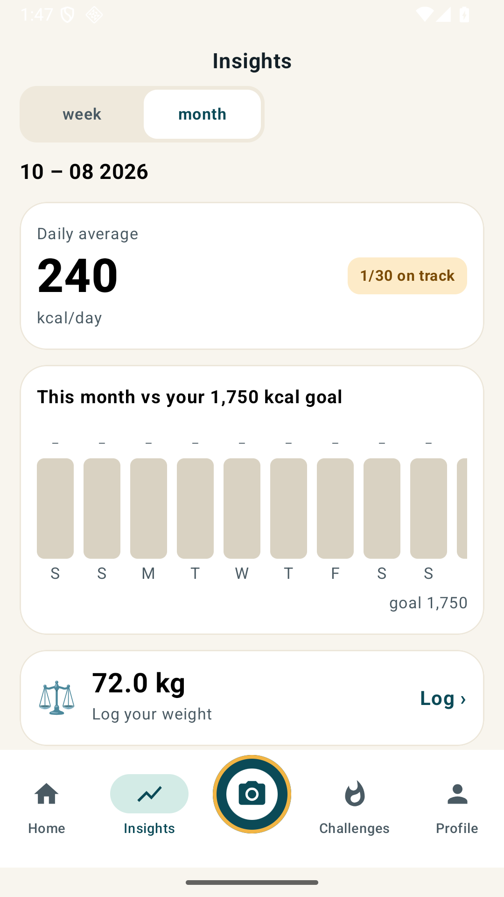

# Mor — Indian calorie tracker 🇮🇳🦚

Snap your meal. Know your calories. A native Android app with a peacock
mascot called **Neelu**, smart food search across **6,900+ foods**, Gemini
photo scanning, and plans tuned for Indian eating.

| Welcome | Home | Scan result |
|---|---|---|
|  |  |  |

## What it does

- **Photo scanning** — point the camera at a thali; Gemini identifies each
  dish with calories and macros, adjustable for less/normal/more oil.
- **Food search that understands you** — plurals, dish names and regional
  names ("eggs" → Boiled egg, "sunny side up" → Fried egg, "channa" → Chole),
  with servings steppers (log two boiled eggs, not one).
- **Voice logging** — "two rotis, a bowl of dal" becomes a logged meal.
- **Real plans** — onboarding (goal, diet, body, target, activity, meal
  times) builds a calorie + macro plan; Home, Insights and Profile all read
  the same saved values.
- **Insights with week/month views**, Challenges with coins, streaks with
  diyas, water + live step tracking via Health Connect, reminders and inbox.
- **Honest states everywhere** — no demo numbers, no hidden failures: offline,
  denied permissions and empty states all say what happened and what to do.

| Plan | Search | Insights |
|---|---|---|
|  |  |  |

## Try it (Android APK)

Download **app-debug.apk** (build it below, or grab it from a maintainer) and
install it on any Android phone — allow *Install unknown apps* once when
prompted. No setup: the app talks to the hosted backend out of the box.

> Demo note: everyone shares one demo account on the hosted server, so meals
> are visible to all testers. The API currently has no auth — don't log
> anything sensitive.

## Screens & design

Every screen is captured in [`design-review/screens/`](design-review/screens/)
(33 shots, fresh from the current build), the bundled artwork is in
[`design-review/assets/`](design-review/assets/), and
[`design-review/SCREENS.md`](design-review/SCREENS.md) maps each screen to its
layout file, assets and API — so visual design can be enhanced without
touching backend or layout code.

## How it's built

```
mor_app/
├── android/    Native Kotlin app (Jetpack Compose + CameraX + Retrofit +
│               Health Connect). Default server: the EC2 backend below.
├── backend/    Express + better-sqlite3 API (port 4000). Holds the Gemini key.
│               Food catalog: ~95 curated Indian dishes + 6,826 USDA SR Legacy
│               rows (public domain — see backend/seed/NOTICE.md) + aliases.
├── app/        Original Vite + React web prototype (reference only).
├── scripts/    Asset pipeline (Gemini image gen + chroma keying).
└── docs/       SPEC-005 camera → Gemini CSV contract, scan results.
```

**Scan flow:** app captures a JPEG → `POST /api/scan` → `gemini-2.5-flash`
returns strict CSV (`backend/src/gemini.js`, SPEC-005) → `scanCsv.js` parses
it → user reviews → `POST /api/meals`. One auto-retry on malformed CSV;
failures keep the photo with retry, and non-food is rejected, never logged.

## Run it yourself

```bash
# Backend (needs a Gemini key)
cd backend
cp .env.example .env          # then set GEMINI_API_KEY
npm install
npm start                     # http://localhost:4000

# Android (needs JDK 17 + Android SDK)
cd android
export JAVA_HOME=/opt/homebrew/opt/openjdk@17
./gradlew assembleDebug       # APK: app/build/outputs/apk/debug/app-debug.apk
```

Point the app at your backend: tap the version line in Profile 5× to reveal
the (dev-only) server setting, or change `DEFAULT_SERVER_URL` in
`android/.../data/Service.kt` before building.

The production backend runs on an EC2 `t3.micro`
(`systemd` service `mor-backend`):

```bash
cd backend
rsync -avz --exclude=node_modules --exclude=data --exclude=uploads --exclude=.env \
  -e "ssh -i ../.ssh/mor-app.pem" ./ ec2-user@15.135.140.52:~/mor/backend/
ssh -i ../.ssh/mor-app.pem ec2-user@15.135.140.52 \
  'cd ~/mor/backend && npm install --omit=dev && sudo systemctl restart mor-backend'
```

Still to do: Elastic IP (the public IP changes if the instance stops) and API
auth before anything sensitive is stored.

## Tests

```bash
cd backend
npm test                      # 39 pass / 0 fail (unit + API, isolated DBs)
GEMINI_API_KEY=... node --test test/api.scan.test.js   # live Gemini round-trip
```

## API surface (`/api`)

health · profile (GET/POST) · home · meals (POST/GET/DELETE) · foods ·
foods/estimate · scan · scans/:id · voice-log · water · weight · insights
(?range=week|month) · streak · challenges · challenges/claim · badges/award ·
notifications · notifications/read · reset

All requests carry `x-user-id` (default 1). Reset wipes that user's data.
